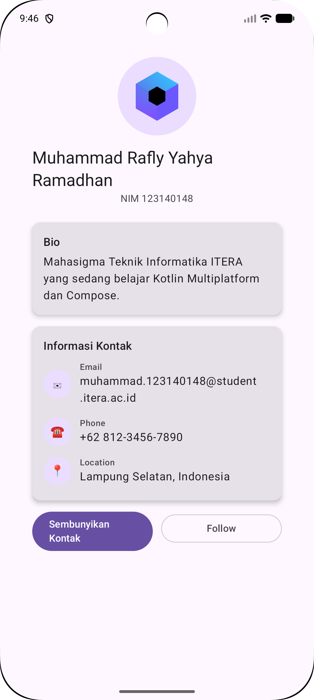

# My Profile App — Compose Multiplatform Basics (Pertemuan 3)

**Nama:** Muhammad Rafly Yahya Ramadhan  **NIM:** 123140148
Mata kuliah Pengembangan Aplikasi Mobile (IF25-22017) — ITERA

## Fitur
- Header dengan foto profil bulat, nama, dan NIM
- Bio singkat
- List informasi: Email, Phone, Location
- Tombol untuk menampilkan/menyembunyikan kontak dengan `AnimatedVisibility` (bonus)

## Composable reusable (`ui/ProfileComponents.kt`)
- `ProfileHeader` — foto + nama + NIM
- `InfoItem` — satu baris ikon + label + nilai
- `ProfileCard` — card berjudul dengan slot isi

## Komponen yang dipakai
Column, Row, Box, Card, Text, Button, OutlinedButton, Image, Modifier (fillMaxWidth, padding, size, clip, background, weight, verticalScroll).

## Screenshot

## Cara menjalankan
- **Android**: buka folder `pekan-3` di Android Studio, pilih `androidApp`, Run.
  Atau: `./gradlew :androidApp:assembleDebug`
- **iOS**: buka `iosApp/iosApp.xcodeproj` di Xcode lalu Run.
