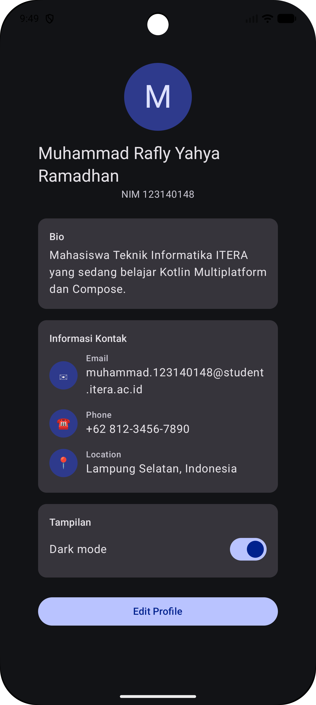
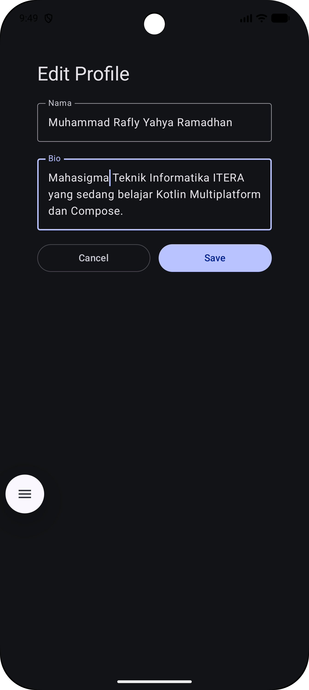

# Profile App — State Management & MVVM (Pertemuan 4)

**Nama:** Muhammad Rafly Yahya Ramadhan  **NIM:** 123140148
Mata kuliah Pengembangan Aplikasi Mobile (IF25-22017) — ITERA

Pengembangan dari My Profile App (Pertemuan 3) dengan arsitektur MVVM,
fitur edit profil, dan dark mode toggle. Dibuat dengan Kotlin Multiplatform + Compose Multiplatform (Android & iOS).

## Fitur
- **MVVM**: `ProfileViewModel` mengekspos `StateFlow<ProfileUiState>`.
- **UI State**: data class `ProfileUiState(profile, isEditing, isDarkMode)` sebagai single source of truth.
- **Edit Profile**: form nama & bio memakai `LabeledTextField` (stateless, state di-hoist); tombol Save memperbarui ViewModel.
- **Dark Mode**: `Switch` yang state-nya disimpan di ViewModel, dengan transisi warna halus (`animateColorAsState`).
- **Composable reusable**: `ProfileHeader`, `InfoItem`, `ProfileCard`, `DarkModeToggle`, `LabeledTextField`.

## Struktur folder
```
shared/src/commonMain/kotlin/.../statemanagementmvvm/
├── data/        Profile.kt (model + ProfileRepository)
├── viewmodel/   ProfileUiState.kt, ProfileViewModel.kt
├── ui/          ProfileScreen, EditProfileScreen, ProfileComponents,
│                LabeledTextField, AppTheme
└── App.kt       root composable
```

## Screenshot
| Profil (dark mode) | Form edit |
|:---:|:---:|
|  |  |

## Cara menjalankan
- **Android**: buka folder `pekan-4` di Android Studio, pilih konfigurasi `androidApp`, Run.
  Atau lewat terminal: `./gradlew :androidApp:assembleDebug`
- **iOS**: buka `iosApp/iosApp.xcodeproj` di Xcode lalu Run.

## Menjalankan test
```
./gradlew :shared:testAndroidHostTest
```
